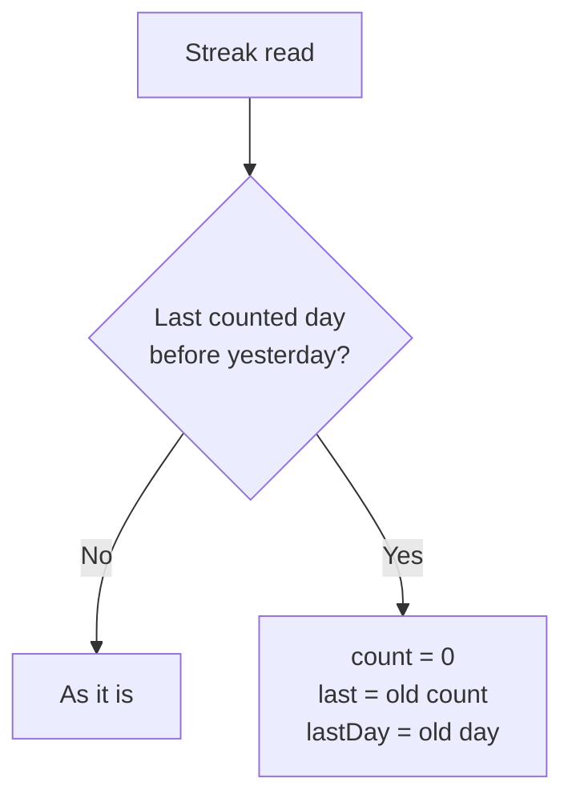
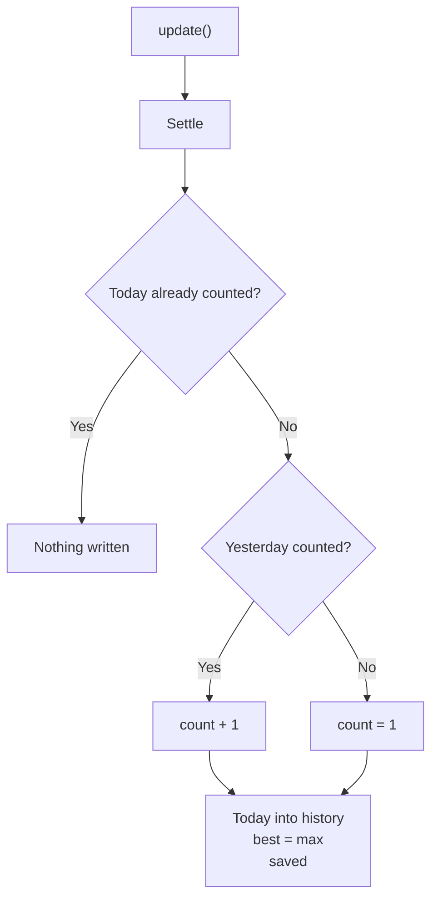
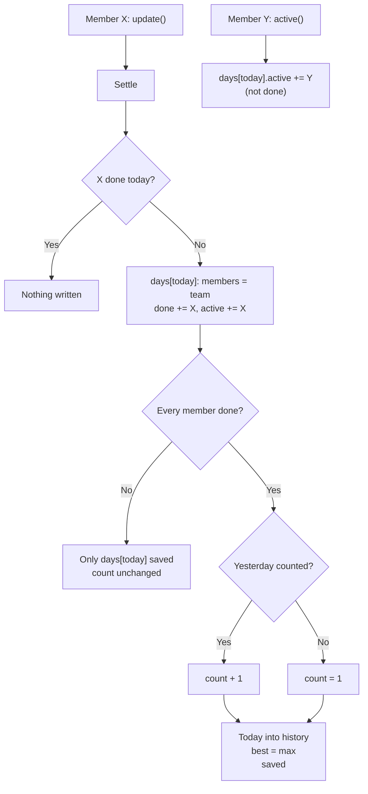
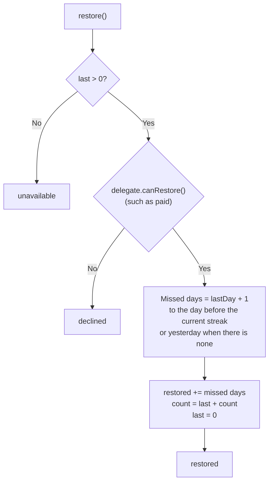
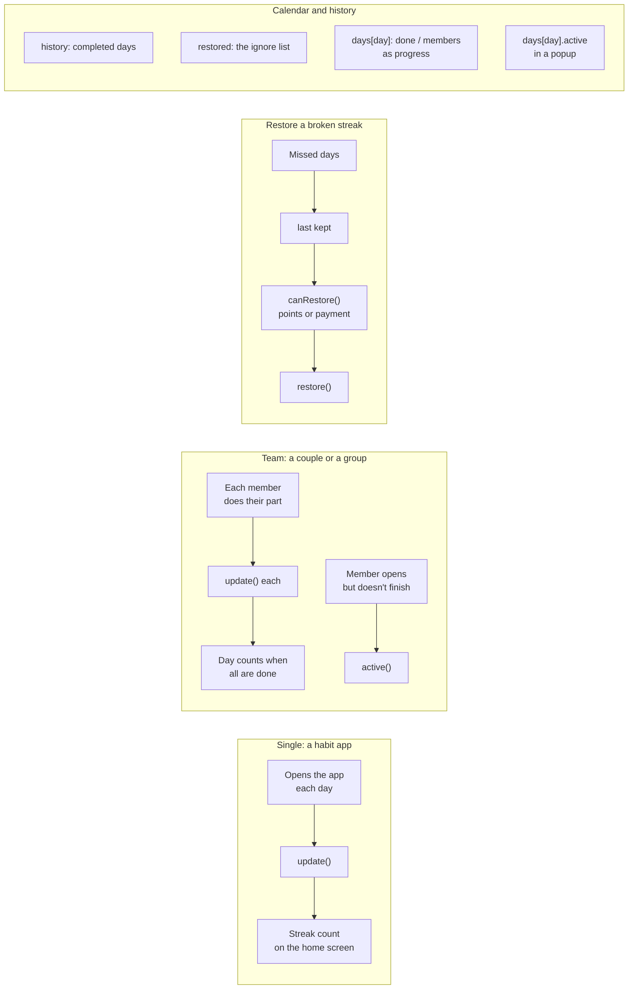

# flutter_streak

Daily streaks for Flutter, alone or in a team, kept wherever you choose through a `StreakDelegate`.

## Features

- A day counts once it is completed; a missed day starts the streak again from 0.
- The longest streak (`best`) and the last broken one (`last`), which `restore()` brings back however long ago it broke.
- Restored days are kept apart (`restored`, the ignore list); counted days in `history`, for a calendar.
- Two modes: `single`, and `team`, where a day counts only once every member completes it. Each team day keeps who
  was in the team, who completed it (`done`, for progress) and who was active.
- `Streak.i.value` at once from anywhere, and `Streak.i.on((latest) {})` for changes.
- `canRestore` on the delegate, to charge for a restore.
- Reads 1.x streaks (`count`, `time`, `history`).

## How it works

Every read settles the streak first: a streak whose last counted day is before yesterday has broken.



### Single mode



### Team mode



### Restore



## Use cases



Example: completed on the 1st and the 2nd, missed the 3rd, completed the 4th: `count` 1, `last` 2. A restore puts the
3rd in `restored`, and `count` is 3.

## Usage

```dart
Streak.i.init(delegate: MyDelegate(), member: uid);                      // single
Streak.i.init(delegate: MyDelegate(), member: uid, mode: StreakMode.team, members: {uid, partnerId});

await Streak.i.update();   // this member completed today
await Streak.i.active();   // team: active today without completing
await Streak.i.restore();  // the last streak back
Streak.i.refresh();        // a day may have passed (back from the background)
Streak.i.clear();          // signed out

final stop = Streak.i.on((latest) => print(latest.count));
```

A delegate keeps the streak and says what day it is:

```dart
class MyDelegate extends StreakDelegate {
  @override
  Stream<Map<String, dynamic>?> listen() => ...;

  /// Atomically, such as in a transaction; `change` may run more than once.
  @override
  Future<Map<String, dynamic>?> write(Map<String, dynamic>? Function(Map<String, dynamic>? stored) change) => ...;

  @override
  Map<String, dynamic>? cached() => ...;   // optional: shown at once

  @override
  DateTime now() => ...;                   // optional: the server's day

  @override
  Future<bool> canRestore(StreakData data) async => ...; // optional: once paid
}
```

See `example/` for an in-memory delegate.
